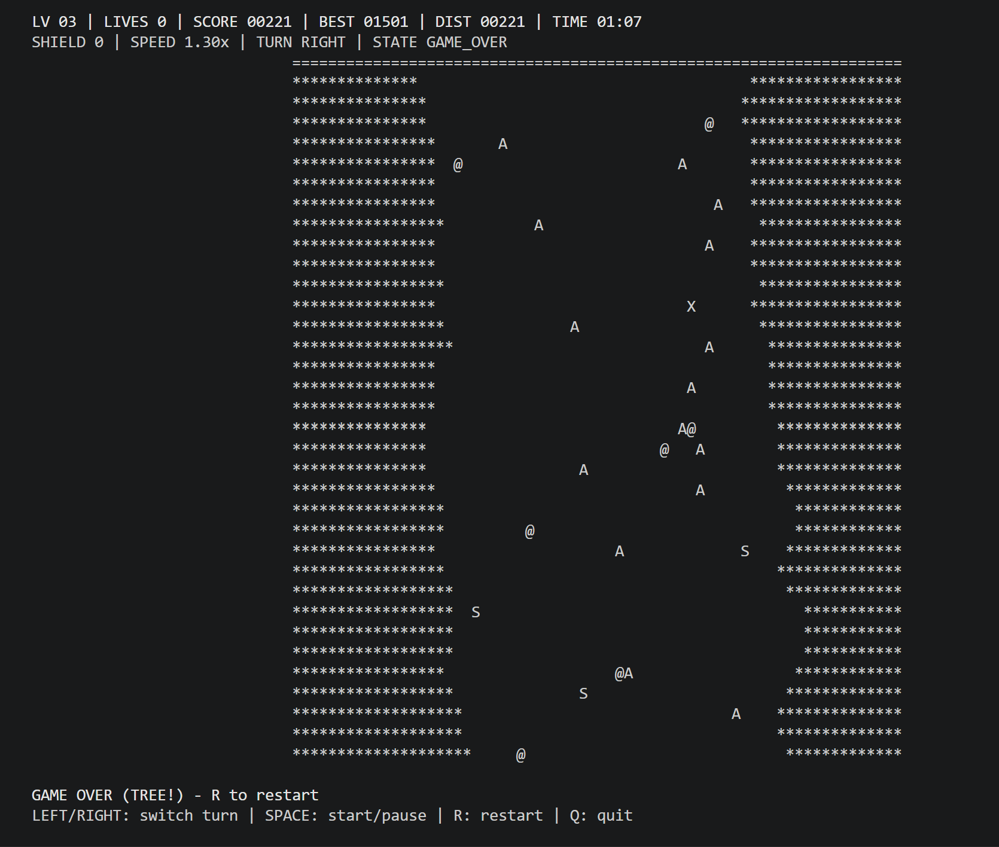

# ASCII Ski Adventure

## 1. ゲーム概要

ASCII文字を使用したスキーゲームです。

プレイヤーを左右に操作し、木や崖などの障害物を避けながら、
コインやシールドを集めてハイスコアを目指します。

ベースとなったゲーム：授業配布のASCIIスキーゲーム

## 2. 動作環境

- OS：Windows 11
- Python：3.14.5
- 開発環境：Visual Studio Code
- 使用ライブラリ：windows-curses（2.4.2）

## 3. インストール方法

GitHubからリポジトリをCloneします。

```bash
git clone https://github.com/AYENYEIN-29/ski-game-final.git
cd ski-game-final
```

必要なライブラリをインストールします。

```bash
python -m pip install -r requirements.txt
```

## 4. 起動方法

VS Codeのターミナルで以下のコマンドを実行します。

```bash
python w11_ski_demo.py
```

ターミナルのサイズは横64文字、縦21行以上にしてください。
画面表示が切れる場合は、ターミナルを広げてください。

## 5. 操作方法

| キー | 操作 |
|---|---|
| N | NORMALモードの選択 |
| H | HARDモードの選択 |
| Space | ゲーム開始・一時停止・再開 |
| ← | 左方向へ移動 |
| → | 右方向へ移動 |
| R | ゲームオーバー後のリスタート |
| Q | ゲーム終了 |

難易度はゲーム開始前に選択します。

## 6. ゲーム内の記号

| 記号 | 意味 |
|---|---|
| `O` | プレイヤー |
| `A` | 木 |
| `*` | 崖 |
| `@` | コイン |
| `S` | シールド |
| `X` | ゲームオーバー時のプレイヤー |

## 7. 追加・改良した機能

### 7-1. スクロール速度の調整

ゲームのスクロール速度を調整し、
プレイヤーが操作しやすくなるように改良しました。

### 7-2. コイン収集機能

コース上にコインがランダムに出現します。
コインを取得すると、スコアが100点加算されます。

障害物を避けるだけでなく、コインを集める楽しさを追加しました。

### 7-3. 難易度選択機能

NORMALとHARDの2種類の難易度を選択できます。

- NORMAL：通常の滑走速度
- HARD：通常より速い滑走速度

プレイヤーの経験や操作能力に合わせて、
難易度を選択できるようにしました。

### 7-4. 3ライフ機能

ゲーム開始時に3つのライフを持っています。

障害物に衝突するとライフが1減少し、
ライフが0になるとゲームオーバーになります。

ライフが残っている場合は、安全な位置に戻り、
ゲームを続けることができます。

### 7-5. ハイスコア保存機能

最高スコアをhigh_score.jsonに保存します。

ゲームを終了して再起動しても、
過去の最高スコアを確認できます。

画面上部にBESTとして最高スコアを表示します。

### 7-6. シールド機能

コース上にシールドアイテム「S」がランダムに出現します。

シールドを取得すると、SHIELDが0から1になります。

シールドを持っている状態で障害物に衝突すると、
ライフの減少を1回防ぐ仕組みを実装しました。

シールドを使用するとSHIELDが0に戻ります。
シールドは最大1個まで所持できます。

## 8. ゲーム画面



## 9. 動作確認

| 確認項目 | 結果 |
|---|---|
| ゲームの起動 | 確認済み |
| コイン取得によるスコア加算 | 確認済み |
| 難易度の切り替え | 確認済み |
| 衝突時のライフ減少 | 確認済み |
| ライフが0になった場合のゲームオーバー | 確認済み |
| ハイスコアの保存と読み込み | 確認済み |
| シールドアイテムの出現 | 確認済み |
| シールドアイテムの取得 | 確認済み |
| シールド所持状態の画面表示 | 確認済み |
|| シールドによるライフ保護 | 確認済み |

## 10. 実装状況と今後の課題

予定していた追加機能は実装済みです。

シールドによるライフ保護についても、
衝突前後の状態を比較し、正常に動作することを確認しました。

今後は、ゲーム画面の見やすさや操作性をさらに改善し、
より楽しめるゲームにしたいと考えています。

## 11. 制作を通して学んだこと

今回の制作を通して、既存のプログラムを理解し、
新しい機能を追加する方法を学びました。

また、機能を追加するたびに動作確認を行い、
問題が発生した場合は原因を調べて修正しました。

GitとGitHubを利用して機能ごとに変更履歴を管理することの
重要性も理解しました。

さらに、第三者がゲームを利用できるように、
READMEを作成することの大切さを学びました。

## 12. 使用技術

- Python
- curses
- JSON
- Git
- GitHub
- Markdown
- Visual Studio Code

## 13. ファイル構成

| ファイル名 | 内容 |
|---|---|
| w11_ski_demo.py | ゲーム本体 |
| requirements.txt | 必要なライブラリ |
| README.md | ゲームの説明書 |
| .gitignore | Gitの管理対象外ファイルの設定 |
| screenshot.png | ゲーム画面の画像 |

high_score.jsonはハイスコア保存時に自動生成されます。